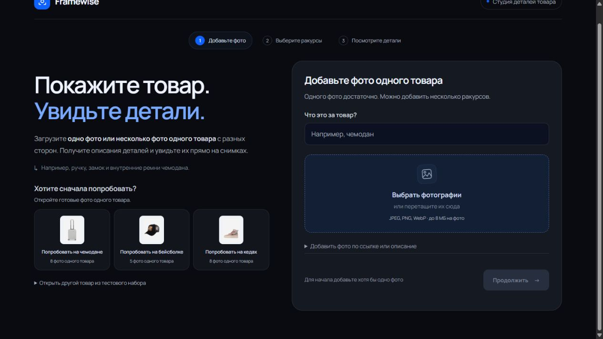

# Framewise

Прототип анализа видимых деталей одного товара по фотографиям. Загрузите одно фото или несколько ракурсов одного товара, укажите название и выберите снимки для анализа. Сервис покажет 3–5 описаний деталей с интерактивными рамками. Фотографии по URL и описание можно добавить по желанию, а для знакомства есть три готовых примера.



Стек — Vue 3, TypeScript, Vite, Python 3.12+, FastAPI, Pydantic, Pillow, OpenAI-совместимый API. Модель — **Qwen3-VL-8B-Instruct Q4_K_M**, идентификатор `qwen3-vl:8b-instruct`. Основания выбора и сравнение с 4B находятся в [R&D-отчёте](docs/RESEARCH.md).

## Запуск через Docker

Требуются Docker Desktop с Linux engine или Docker Engine с Compose и доступ в интернет для первого скачивания образов и модели.

```sh
docker compose up --build
```

Откройте <http://localhost:8080>. Сервис `model-init` скачивает Qwen3-VL 8B Instruct в постоянный Docker volume. Веса и vision projector занимают примерно 6,2 ГБ, отдельно скачиваются образы контейнеров. Первый запуск зависит от скорости сети. Последующие используют кэш. Запросы выполняются локально, API-ключ для этого режима не требуется.

Для NVIDIA GPU с поддержкой контейнеров:

```sh
docker compose -f compose.yaml -f compose.gpu.yaml up --build
```

На CPU обработка нескольких фото занимает существенно больше времени. В Docker общий бюджет операции модели — 300 секунд; при прямом запуске default — 180 секунд. Он включает очередь и одну попытку исправления ответа. Состояние сервисов и ошибки доступны через `docker compose ps` и `docker compose logs -f backend model model-init`.

Остановка — `docker compose down`. Модель в volume сохраняется.

## Запуск в Windows без Docker

Установите Python 3.12+, Node.js 22.13+ (или 24 LTS) и PowerShell. Для протестированного CUDA-runtime нужен совместимый NVIDIA-драйвер. Скрипт скачивает официальный llama.cpp и веса с проверкой SHA-256, создаёт Python-окружение и устанавливает npm-зависимости:

```powershell
./scripts/start-local.ps1
```

Откройте <http://127.0.0.1:5173>. API доступен на <http://127.0.0.1:8000>, Swagger — <http://127.0.0.1:8000/docs>. Логи находятся в `.runtime/`. Порт модели — `11436`.

Для остановки процессов, запущенных скриптами, выполните `./scripts/stop-local.ps1`.

Можно запустить части вручную. Сначала `scripts/start-model.ps1`, затем из `backend/`:

```sh
python -m venv ../.venv
../.venv/Scripts/python -m pip install -r requirements.txt
../.venv/Scripts/python -m uvicorn app.main:app --host 127.0.0.1 --port 8000
```

В отдельном терминале из `frontend/`:

```sh
npm ci
npm run dev
```

## Переменные окружения

Для Docker скопируйте `.env.example` в `.env`, если нужны изменения. Для ручного запуска API используйте `backend/.env` или переменные процесса. В native-режиме адрес модели — `http://127.0.0.1:11436/v1`, в Compose — `http://model:11434/v1`.

| Переменная | Назначение |
|---|---|
| `MODEL_BASE_URL` | Корень OpenAI-совместимого API, включая `/v1` |
| `MODEL_NAME` | Точный идентификатор модели |
| `MODEL_API_KEY` | Ключ провайдера. Для локальной модели подходит `local` |
| `MODEL_RESPONSE_FORMAT` | `json_schema` или `json_object`; Pydantic проверяет оба варианта |
| `MODEL_TIMEOUT_SECONDS` | Общий бюджет операции: очередь, запрос и одна попытка исправления |
| `LOCAL_MODEL_NAME` | Тег модели, скачиваемой `model-init` в Docker |
| `DATA_DIR` | Путь к каталогу с CSV и папкой `images/` |

Для внешнего API задайте его URL, модель и ключ. В Docker можно запустить только приложение без локального inference:

```sh
docker compose up --build --no-deps backend frontend
```

Совместимость формата запроса и качество выбранной внешней модели необходимо проверить отдельно. Секреты находятся только на сервере и исключены из Git.

## Сценарий проверки

1. На первом экране укажите название товара, например «Чемодан», и добавьте одно фото или несколько фото этого же товара с разных сторон. Можно выбирать файлы JPEG/PNG/WebP или перетаскивать их в область загрузки.
2. При желании раскройте «Добавить фото по ссылке или описание». Прямые публичные URL указываются по одному на строке, описание необязательно.
3. Нажмите «Продолжить». Приложение покажет подготовленные фотографии и отметит первые четыре или все, если их меньше.
4. Оставьте от одного до четырёх снимков для анализа или нажмите «Выбрать ракурсы автоматически». Предложенный моделью набор можно изменить перед анализом.
5. Нажмите «Найти детали на N фото». Нажатие на описание переключает фото и выделяет соответствующую область. Рамки также доступны с клавиатуры.
6. Измените отмеченные фото и повторите поиск деталей. Для нового товара нажмите «Другой товар» и загрузите его фотографии.

Для знакомства на первом экране доступны три готовых примера — чемодан, бейсболка и кеды. ID другого товара из CSV можно ввести в раскрываемом блоке «Открыть другой товар из тестового набора».

Ограничения — до 20 входных фото, до 8 МБ и 24 мегапикселей на изображение. Перенаправляющие URL нужно заменить на прямые. Ручные товары хранятся в памяти один час. При перезапуске API они исчезают.

Модель получает фотографии и название как ориентир, какой предмет рассматривать среди нескольких. Маркетинговое описание исключено: в экспериментах его свойства переносились в ответы без подтверждения на фото. Название также не считается доказательством видимого свойства. Если на фото недостаточно различимых деталей, приложение предлагает другой ракурс.

## Проверки и исследования

```sh
cd backend
../.venv/Scripts/python -m pip install -e ".[test]"
../.venv/Scripts/python -m pytest -q
```

```sh
cd frontend
npm ci
npm run lint
npm test
npm run build
```

- [Аудит исходных данных](data/audit.md) — распаковка 119 JPEG, соответствие CSV, хеши и повторы.
- [Архитектурное ревью и исправления](docs/CODE_REVIEW.md) — границы слоёв, найденные дефекты и проверка изменений.
- [Архитектура и обоснования](docs/ARCHITECTURE.md) — решения, API и ограничения.
- [R&D-отчёт](docs/RESEARCH.md) — источники, сравнение моделей и итерации prompts.
- [Матрица требований](docs/ACCEPTANCE.md) — связь пунктов ТЗ с проверками.
- [Проверка запуска](docs/RUN_VERIFICATION.md) — фактические результаты на машине разработки.

Исходные фото и данные находятся в `data/`. Четыре заранее выбранных случая и приблизительные ручные рамки — в `evaluation/fixtures/`. Их нельзя считать независимой тестовой выборкой после использования для настройки prompts.

## Работа с AI-инструментами

Автор проекта формулировал требования, уточнял пользовательский сценарий и давал обратную связь по интерфейсу. Codex использовался для аудита задания, исследования и сравнения моделей, подготовки кода, тестов и документации. Через инструменты Codex выполнялись сборка, автоматические проверки, реальные VLM-запросы и браузерные сценарии. R&D-результаты и ограничения сохранены для последующей самостоятельной проверки.
