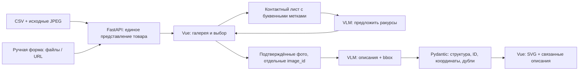

# Архитектура Framewise

Приложение получает товар из CSV или из ручной формы, позволяет выбрать фотографии, вызывает мультимодальную модель и связывает описания с областями на снимках. Успешный анализ содержит 3–5 визуально подтверждаемых особенностей. Это прототип для предоставленного тестового задания.

Преобразование описаний каталога в читаемый обычный текст находится в `frontend/src/presentation/`. API сохраняет исходный description, renderer не вставляет HTML в страницу. Пунктуация отображения также нормализуется на этой границе. Автовыбор доступен через отдельную кнопку «Подобрать фото с ИИ» перед галереей и использует прежний `/api/suggest`.

## Поток данных

Первый экран предлагает загрузить фото **одного товара**: достаточно одного снимка, несколько ракурсов помогают увидеть больше деталей. Превью можно добавлять и удалять до отправки. После подготовки первые четыре фото отмечены, выбор можно изменить вручную или запросить у модели. Название требуется как ориентир предмета. URL, описание и ввод ID из CSV находятся в раскрываемых блоках. Три примера позволяют проверить сценарий без своих файлов. Переход к другому товару очищает файлы и поля, чтобы снимки разных вещей не смешивались.

Ручной выбор сразу переходит к анализу. После автоматического выбора человек может изменить набор. При смене товара, набора снимков и запуске следующего анализа предыдущий результат очищается.

## Слои backend

| Слой | Ответственность | Файлы |
|---|---|---|
| HTTP | Формы и JSON, зависимости FastAPI, DTO, перевод `AppError` в HTTP-ответ | `backend/app/main.py`, `schemas.py` |
| Ограничения HTTP | Admission до чтения тела, размер и время загрузки, наблюдение за disconnect | `backend/app/http_limits.py` |
| Сценарий приложения | Атомарный импорт ручного товара, общий бюджет выбора/анализа и lease данных | `backend/app/services.py` |
| Домен | Неизменяемые `CanonicalImage`, `Photo`, `Product` | `backend/app/domain.py` |
| Хранилище | CSV-каталог, временные товары, capacity, TTL и активные leases | `backend/app/store.py` |
| Изображения и сеть | Нормализация Pillow, проверка URL, DNS pinning, загрузка байтов | `backend/app/images.py` |
| Блокирующая работа | Ограничение числа submitted jobs, включая работу после отмены её ожидания | `backend/app/workers.py` |
| VLM | Подготовка model payload, SDK, envelope и проверка структурированного ответа | `backend/app/model.py` |

`ProductService` использует типизированный контракт `VisionGateway`. Рабочий `VisionModel` создаётся в lifespan, тесты могут явно подставить другой gateway. Домен и хранилище не зависят от FastAPI. Преобразование доменных значений в HTTP DTO находится в `schemas.py`; ошибки приложения сериализует HTTP-адаптер.

## Время жизни и ограничения ресурсов

Lifespan создаёт CPU workers, клиент импорта изображений, отдельный DNS pool, SDK-клиент и задачу очистки. `AsyncExitStack` освобождает принадлежащие приложению ресурсы при обычной остановке и при исключении. Переданный извне тестовый gateway остаётся ответственностью вызывающего кода.

Каталог собирается во временных структурах, проверяется по путям и объёму памяти, затем публикуется целиком под lock. Ошибка загрузки сохраняет предыдущее полное состояние. Данные ручного товара публикуются после успешной подготовки всех его фотографий. Очистка по TTL выполняется каждые 30 секунд. Lease удерживает товар на время выбора или анализа, освобождается через `finally` и обновляет часовой TTL после окончания операции. При остановке API содержимое store очищается.

| Ограничение | Поставляемое значение | Область действия |
|---|---|---|
| `MODEL_TIMEOUT_SECONDS` | 300 s в конфигурациях запуска; 180 s в `Settings` без переопределения | Один бюджет операции VLM, включая ожидание semaphore, основной вызов, один repair и валидацию |
| `MAX_MODEL_REQUESTS` | 4 | Общее число принятых HTTP-запросов выбора/анализа, включая ожидающие GPU |
| `MANUAL_IMPORT_TIMEOUT_SECONDS` | 60 s | Подготовка ручного товара целиком, включая чтение тела, все файлы и URL |
| `IMAGE_URL_TIMEOUT_SECONDS` | 20 s | DNS и полный поток одного изображения |
| `BODY_READ_TIMEOUT_SECONDS` | 15 s | Чтение JSON-тела до обработки операции |
| `MAX_CONCURRENT_IMPORTS` | 2 | Импорты, допущенные до буферизации тела и multipart parsing |
| `IMAGE_WORKERS` | 2 | Submitted CPU jobs для изображений; отдельный DNS pool ограничен числом импортов |
| JSON body | 64 KiB | Проверяется также при отсутствии `Content-Length` |
| Multipart body | 161 MiB при стандартных лимитах | До 20 файлов по 8 MiB и 1 MiB на поля/обрамление |
| Store | 256 MiB, до 30 ручных товаров | Объём подготовленных JPEG, включая каталог |

Admission возвращает 503, когда места нет. Тело запроса проверяется до multipart parsing. При стандартной конфигурации одновременно могут буферизоваться два тела до 161 MiB; декодирование изображений и store требуют дополнительной памяти. Ограничение store в 256 MiB не является лимитом всей памяти процесса.

`WorkerPool` получает permit до `executor.submit`. Отмена HTTP-запроса отменяет ожидание, а permit освобождается после завершения реального `concurrentFuture`. Поэтому серия отмен не создаёт неограниченную очередь WorkItems с удерживаемыми байтами. Уже выполняющийся OS DNS или Pillow-вызов нельзя принудительно прервать безопасно; он занимает ограниченный слот до завершения.

После disconnect приложение отменяет обработку запроса, освобождает очередь VLM и lease. Отмена распространяется в SDK-вызов. Фактическое прекращение вычислений на стороне внешнего провайдера зависит от его реализации.

## Изоляция URL-импорта

Импорт разрешает публичные HTTP(S)-адреса на портах 80/443. Проверяются все результаты DNS, соединение закрепляется за проверенным IP. Заголовок `Host` и TLS SNI сохраняют исходное имя сервера. При ошибке соединения можно попробовать следующий проверенный адрес в рамках того же дедлайна.

У pinned-запроса IP становится ключом connection pool. Поэтому клиент изображений использует `max_keepalive_connections=0` и отключённый HTTP/2. Каждый следующий запрос устанавливает соединение с TLS-проверкой своего исходного hostname. Cookie policy запрещает сохранять и отправлять cookies между запросами, включая разные имена, указывающие на один IP. Переменные proxy окружения и redirects отключены.

Проверяются MIME, заявленная и фактическая длина потока, декодирование, разрешение и формат изображения. Клиент запрашивает `Accept-Encoding: identity`, отклоняет дополнительное HTTP-сжатие и ограничивает сырые байты потока до декодирования. JPEG/PNG/WebP затем проходят обычную нормализацию Pillow.

## Решения и основания

| Решение | Причина | Проверка / ограничение |
|---|---|---|
| Vue 3 + TypeScript + Vite | Состояние сценария небольшое. Типы фиксируют границу JSON API. Vite собирает статический клиент | `npm run build` включает `vue-tsc` |
| FastAPI + Pydantic | Python требуется заданием. Схемы одновременно описывают API и проверяют ответы VLM | HTTP-тесты проверяют каталог, ручные товары, выбор и анализ |
| Python OpenAI SDK с настраиваемыми `base_url` и `model` | Требование OpenAI-совместимого API. Один адаптер обслуживает локальную модель и совместимый внешний сервис | Реальный локальный запрос и mock-тесты ошибок. Смена провайдера требует отдельного smoke-теста |
| Раздельные операции выбора и анализа VLM | Пользователь должен подтвердить предложенные кадры перед анализом | `suggest` и `analyze` имеют разные схемы и prompts. Основной вызов и возможный repair делят бюджет своей операции |
| Прямой SDK | Два вызова и явная валидация выражаются несколькими функциями. Дополнительная цепочка LangChain не сокращает этот поток | Управление запросами сосредоточено в `backend/app/model.py` |
| Контактный лист для выбора | В пробе пять отдельных изображений превысили исходный контекст 4K. Лист позволил выбрать два фото кед и исключить три служебных кадра | Новая конфигурация имеет контекст 12K. Качество большого листа проверяется отдельно |
| Буквенные метки `PHOTO A…` | Маленькая модель путала номер клетки с числовым суффиксом ID файла | Бэкенд сопоставляет буквы с фактическими ID, модель не конструирует ID самостоятельно |
| Отдельные фотографии для анализа | На листе превью недостаточно деталей для точного bbox. Каждый ответ должен указывать конкретный снимок | До четырёх снимков на запрос, собственная система координат у каждого |
| В VLM отправляются фото и название как ориентир предмета, описание остаётся в UI | Полное описание провоцировало неподтверждённые характеристики. Название помогает выделить нужную вещь среди другой экипировки, но не служит доказательством свойств | Name-only пробы на куртке, кедах и таблице размеров; противоречащие пикселям свойства игнорируются |
| Единые канонические байты фото для UI и VLM | EXIF-поворот и разные преобразования могут смещать рамки | Pillow применяет EXIF, сохраняет пропорции, ограничивает сторону до 1600px, конвертирует в RGB/JPEG. Тесты включают EXIF и прозрачность |
| Нормализованный `xyxy` 0–1000 | Размер изображения в интерфейсе может меняться. Относительные координаты сохраняют положение детали | SVG `viewBox="0 0 1000 1000"` растягивается ровно на изображение. Измеряется DOM-геометрия на двух ширинах |
| JSON Schema + Pydantic | Синтаксически корректный JSON может содержать чужой ID, отрицательную площадь или повтор | Проверяются допустимые ID, целые координаты, границы, положительная площадь, число признаков, точные дубли описаний и рамок |
| Один repair при неверном ответе | Исправление схемы иногда достаточно. Неограниченные повторы расходуют время и скрывают нестабильность | После двух неверных ответов API возвращает понятную ошибку. Таймауты и 429 не запускают скрытую цепочку запросов |
| Один проход анализа вместо отдельной повторной локализации | В проверке восьми признаков второй проход оставил 5/8 подходящих рамок и добавил около 9 секунд. Усложнение не принесло измеримого улучшения | Сырые ответы и ручная оценка `8b-second-pass` сохранены в `evaluation/results/` |
| `insufficient_evidence` | Пустой кадр не поддерживает обязательные 3–5 признаков | Для отказа требуется пустой массив. API предлагает добавить другой ракурс |
| Последовательные VLM-запросы | Локальная GPU обслуживает один интерактивный сценарий. Параллельные запросы ухудшали измерение времени и могли исчерпать VRAM | Один semaphore удерживается на основной вызов и repair. Admission и общий deadline ограничивают очередь. Для нескольких процессов нужен общий диспетчер |
| CSV и временное хранилище | Набор содержит 15 товаров. По ТЗ сохранять ручные товары и историю не требуется | Каталог загружается при старте. Ручные товары ограничены по памяти и количеству. Активный анализ удерживает товар, после завершения обновляется часовой TTL |
| Ограниченная загрузка URL | Функция должна скачивать фото, сохраняя доступ приложения к локальному окружению | Публичные адреса, допустимые порты, DNS pinning, TLS-проверка, лимиты размера/времени, проверка MIME и декодирования |
| SVG-наложение | Нативная векторная геометрия масштабируется с фото и допускает focus/click/hover | Отдельный компонент `AnalysisResults.vue`, поддержка Enter/Space |
| Docker Compose | Одинаковая связка клиента, API и локальной модели воспроизводится вне машины автора | Первый запуск скачивает модель. GPU-override отделён от CPU-конфигурации |

## Контракты API

- `GET /api/products` возвращает список `{id,name}`.
- `GET /api/products/{id}` возвращает `{id,name,description,images:[{id,url,width,height}]}`.
- `POST /api/products/manual` принимает multipart `name`, `description`, повторяемые `files` и `urls` как JSON-массив.
- `POST /api/suggest` принимает `{product_id,image_ids}` и возвращает `{selected_image_ids,reason}`.
- `POST /api/analyze` принимает тот же вход и возвращает `{features:[{id,image_id,description,bbox}]}`.
- `GET /api/media/{id}` отдаёт подготовленный JPEG.
- `GET /api/health` сообщает о работающем API и его конфигурации. Это не проверка готовности VLM.

Ошибки приложения возвращаются как `detail: {code,message}`. Ошибки валидации входа FastAPI имеют стандартный массив `detail`, который клиент также отображает.

`/api/health` показывает адрес провайдера с удалёнными credentials, query и fragment. Статус health подтверждает доступность API; готовность модели проверяется отдельным обращением к ней.

## Границы оценки

Схема и числовые ограничения проверяются программно. Истинность описания и семантическая точность рамки оцениваются на изображениях вручную. Автоматическая проверка структуры не подтверждает качество распознавания.

Ручные рамки в `evaluation/fixtures/cases.json` приблизительные. IoU подходит для конкретных заранее заданных объектов, например ручки чемодана. Для свободно выбранного моделью признака требуется отдельно проверить описание и область. Небольшая выборка является набором разработки. Результаты на ней не устанавливают качество на новых товарах.

Подробные гипотезы, источники, prompts, сырые ответы, изменения между итерациями и итоговый выбор модели находятся в `RESEARCH.md` и `evaluation/`.
